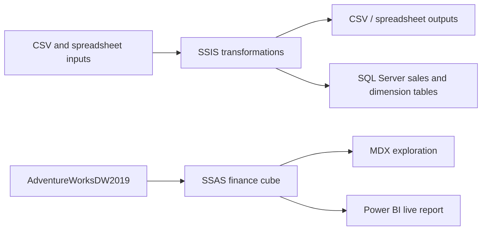
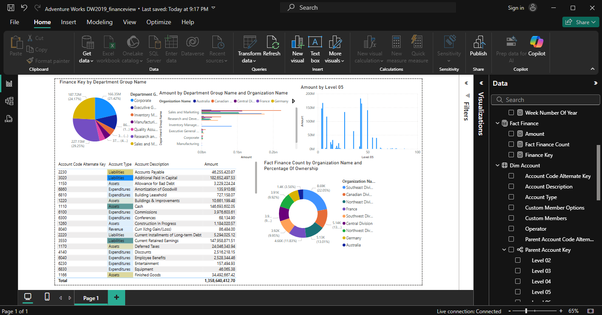
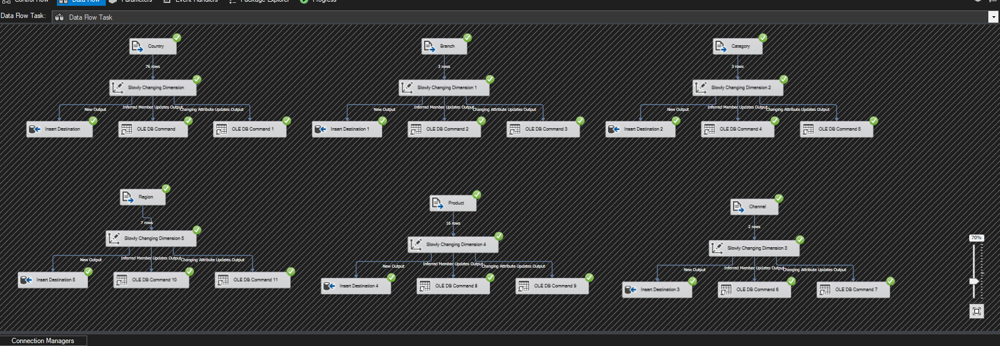

<div align="center">

# ETL & OLAP Analytics

### Data integration, dimensional loading, and financial cube exploration

**SQL Server · SSIS · SSAS Multidimensional · MDX · Power BI**

[Architecture](#architecture) · [Project components](#project-components) · [Report preview](#report-preview) · [Technical report](docs/technical-report.md) · [Setup](docs/setup.md)

</div>

---

## Overview

A portfolio case study covering data integration with SQL Server Integration Services, dimensional loading, and finance analytics with an Analysis Services cube and Power BI.

The repository contains **four SSIS projects**, an **SSAS finance cube with five dimensions**, and a **one-page Power BI report with five visuals**. Historical screenshots document the original implementation. Source files have been organized and connection settings generalized for sharing; the edited projects have not yet been rebuilt or executed in a fresh environment.

## Architecture



The integration examples and AdventureWorks finance analysis are **two related demonstrations**. The supplied files do not establish a single automated path from the B1 sales data into the finance cube.

## Project components

| Component | What the source implements |
| --- | --- |
| CsvAggregation | Flat File Source → Aggregate → Flat File Destination |
| SpreadsheetConsolidation | Two Excel sources → Union All → Aggregate → Excel destination |
| SalesUpsert | Two CSV sources and one SQL source → Union All → Aggregate → Lookup → update/insert commands |
| DimensionalWarehouse | Six reference-data loads, six SCD components, and a regional sales consolidation flow with four dimension lookups |
| FinanceCube | Fact Finance measure group with Account, Date, Department Group, Organization, and Scenario dimensions; a separate date measure group is also present |
| FinanceAnalytics.pbix | Live connection to SSAS, with account, organization, and department visuals |

## Report preview



<details>
<summary><strong>Dimensional loading and SCD processing</strong></summary>



*Historical SSIS evidence. Green checks document that captured run; they do not validate the edited source in another environment.*

</details>

## Verified data checks

The locally supplied B1 sales sample contains **100 records and 100 distinct order IDs**, covering **2 February 2010–22 May 2017**. The six regional files contain the same 100 records as the consolidated file. Checks found no exact duplicate sales rows, missing CSV values, orphaned region/country/product/channel IDs, or ship dates before order dates.

## Repository layout

```text
etl-olap-analytics/
├── ssis/         Four integration projects and package definitions
├── ssas/         Finance cube, dimensions, data source views, and partitions
├── powerbi/      Original live-connected PBIX report and connection notes
├── sql/          Read-only finance reconciliation queries
├── mdx/          Reconstructed exploration examples
├── scripts/      Read-only B1 validation tool
├── reports/      Measured data checks and report-layout inventory
├── assets/       Original technical screenshots
├── docs/         Technical report, evidence guide, and setup
└── data/         Source acquisition and handling notes
```

## Reproduce and extend

Start with [setup and prerequisites](docs/setup.md). Download AdventureWorks from [Microsoft's official sample database documentation](https://learn.microsoft.com/en-us/sql/samples/adventureworks-install-configure?view=sql-server-ver16). Obtain your own permitted B1 inputs and the missing demonstration inputs before running their packages.

For the available local B1 files:

```powershell
python scripts/validate_b1.py --data-root "C:\path\to\B1" --output "validation.json"
```

This command profiles CSV files only. It does not deploy SSIS, restore a database, process a cube, or refresh Power BI.

## Data attribution

AdventureWorksDW2019 is a Microsoft sample database. Use the [official SQL Server samples repository](https://github.com/microsoft/sql-server-samples) and its applicable license notices when acquiring or redistributing Microsoft material. The locally supplied backup is excluded and has not been compared with an official release checksum. B1 is separately supplied sample data with unverified provenance and is not redistributed. A license for this project's original code has not yet been selected.
